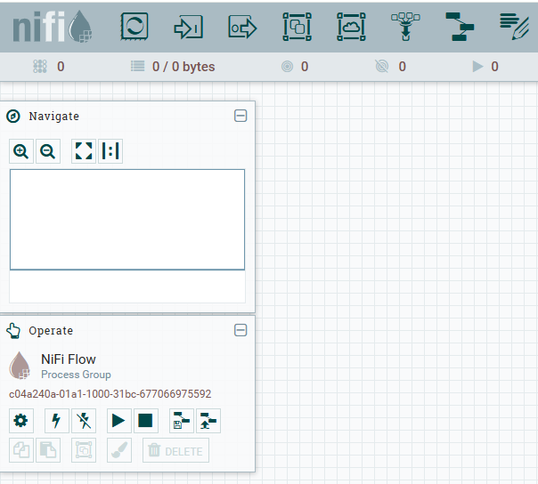

# BigData05 - install nifi

we install NiFi as as ELT tool. Besides its streaming capability<br>
Nifi can also be used to read data from RDBMS systems, so we use it as replacement for outdated [Sqoop](https://sqoop.apache.org/)

```bash
sudo -s
```

we best use older Nifi versioon 1.28.1 (instead of 2.12.0, which supports Java 21 only)
```bash
cd /usr/local
export NIFI_VERSION=1.28.1
wget https://dlcdn.apache.org/nifi/${NIFI_VERSION}/nifi-${NIFI_VERSION}-bin.zip
unzip nifi-${NIFI_VERSION}-bin.zip
ln -sf nifi-${NIFI_VERSION} nifi
rm nifi-${NIFI_VERSION}-bin.zip # to save space
chown -R hduser:hadoop nifi*
```

switch to `hduser`
```bash
su - hduser
```

adapt environment for Nifi
```bash
cat >> ~/.bashrc <<!
export NIFI_HOME=/usr/local/nifi
export PATH=\$PATH:\$NIFI_HOME/bin
!
source ~/.bashrc
```
best generate a random SSL key and write it to nifi.properties file<br>
in the default configuration file we have changed to use http instead of https, which is easier to configure (and use 0.0.0.0 instead of 127.0.0.1):

```bash
cp ~/BigData/scripts/05/nifi.properties $NIFI_HOME/conf/
sslkey=$(openssl rand -hex 32)
sed -i "s/325967d71cd78f5742e4b4c5563223390d9c50199df8079f67dc80a3779324ad/${sslkey}/" $NIFI_HOME/conf/nifi.properties
```

start NiFi for the first time and check logs, if you see some error
```bash
nifi.sh start
nifi.sh status
tail -f $NIFI_HOME/logs/nifi-app.log
```

You should see your Nifi configuration page under following URL:
> [http://\<OpenStackVM-IP\>:8999/nifi](http://<OpenStackVM-IP>:8999/nifi)

It should look as below:



if you later want to stop `Nifi`, then simply call `nifi.sh stop`

continue with script 05n_nifi_read_from_rdbms_to_hdfs.md