# BigData05 - read from RDBMS with Nifi

we will use Nifi to read from MySQL database to Hive

## prepare source and destination tables

switch to `hduser`
```bash
su - hduser
```

create hive destination table as external table. As Nifi uses binary [Parquet](https://de.wikipedia.org/wiki/Apache_Parquet) as output format, this has to be told to Hive.

```bash
export HIVE_CONNECT_STRING=localhost:10000
beeline --verbose -u jdbc:hive2://$HIVE_CONNECT_STRING scott tiger <<!
DROP TABLE IF EXISTS StudentsNifi;
-- the entry_date column should be string, as date fields cannot easily be mapped between MySQL and hive
CREATE EXTERNAL TABLE IF NOT EXISTS StudentsNifi (
    id         INT,
    first_name STRING,
    last_name  STRING,
    entry_date STRING,
    course     STRING
)
STORED AS PARQUET
LOCATION '/user/hduser/hive_external/students';
!

hdfs dfs -mkdir -p /user/hduser/hive_external/students
# check, if necessary
hdfs dfs -chmod 777 /user/hduser/hive_external/students
```

fill some test data into MySQL source table `studentsMySQL`:
```bash
export MYSQL_USER=$(echo ${HOSTNAME//bigdata})
export MYSQL_PASSWD=$MYSQL_USER
export DATABASE_NAME=$MYSQL_USER
mysql --ssl=FALSE -u $MYSQLUSER -D $DATABASE_NAME  -h datanode1 -P 13306 --password=$MYSQL_PASSWD < ~/BigData/scripts/05/insertstudentsMySQL.sql
```

## configure Nifi in Web GUI

then we need to configure NiFi using Web GUI on port 8999/nifi:

> you can skip all those steps, when loading xml file scripts/05/MySqlToHive_NifiTemplate.xml via the following icon


Otherwise continue with the step-by-step guide...

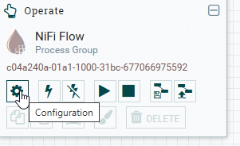

add a new controller service:<br>

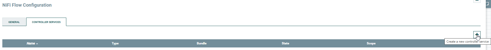

of type DBCPConnectionPool:<br>

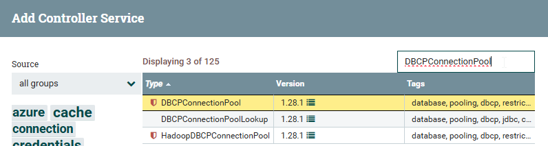

rename the pool to a meaningful value:<br>

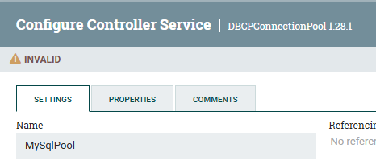

and set following properties (replace `swd00` by e.g. `itm01` or `swd01` inside of blue borders and take values in green borders as they are):<br>

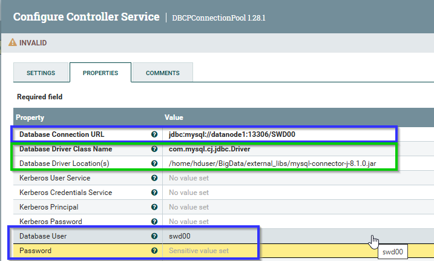

press the `flash` icon to enable the service:<br>

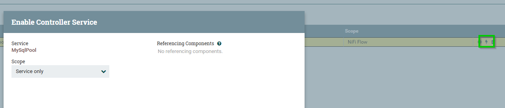

add a new processor by dragging the following icon to the canvas board:<br>

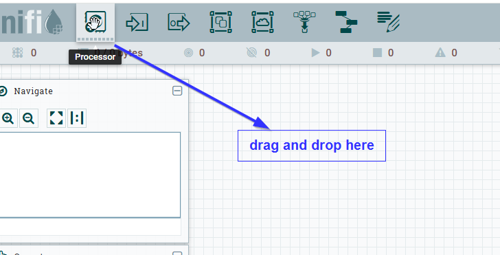

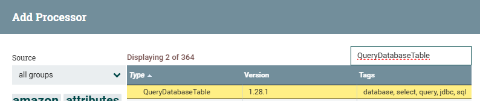

set at least following values in the processor's properties (field "Maximum-value Columns" is used to find new inserts basing on ascending `id`)<br>
> IMPORTANT: table names, database names etc. are case sensitive !!!

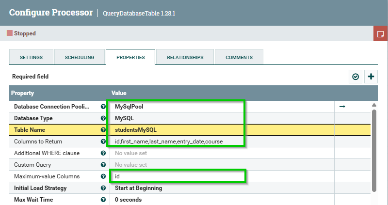

then add processor to write the data from MySQL to HDFS:<br>


and set the proper values for record reader and writer as below (you can keep the default names or also give them meaningful values):<br>

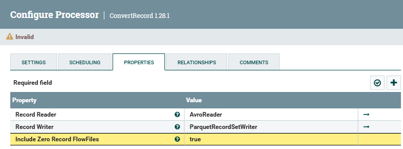

add the end you should see the following 3 services, all 3 enabled:<br>

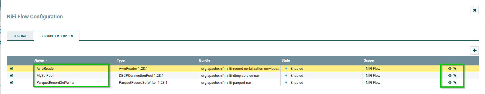

add a processor to write to HDFS:<br>

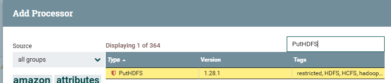

and configure hadoop config files and the proper hive external directory:<br>

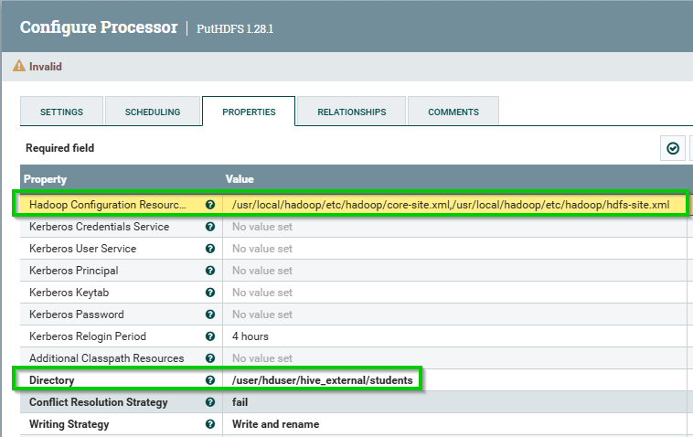

and then tell Nifi to end the processing after this step (other steps might also terminate in case of failure):<br>

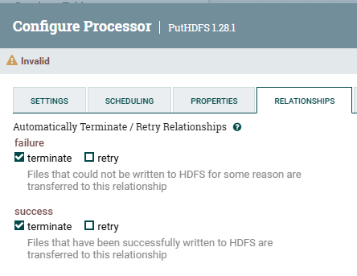

--then create an UpdateAttribute processor to configure target file names <br>
--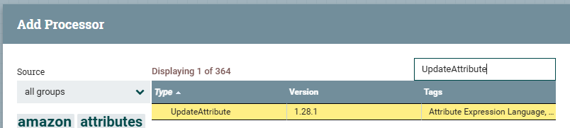

in the end your screen should look as below and pressing the `Play` button of the flow should show success:<br>

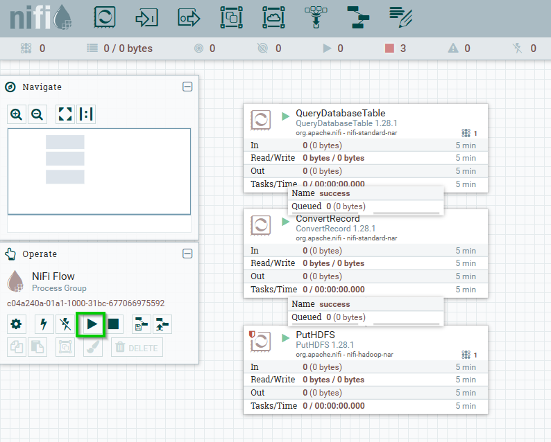

if all went well, you should see in the web GUI, that some bytes were read and written<br>
and you should find a non-empty file in the HDFS target directory:

```bash
hdfs dfs -ls /user/hduser/hive_external/students
```

and then check the content of the destination table, which should find all records:<br>
```bash
export HIVE_CONNECT_STRING=localhost:10000
beeline --verbose -u jdbc:hive2://$HIVE_CONNECT_STRING scott tiger <<!
select * from StudentsNifi;
!
```

the graphical configuration can be exported using a template (IMPORTANT: the complete NiFi Flow should be shown - and not only one step):<br>


and then download the created template:


## additional task: test incremental synchronisation

when inserting some additional records to source table with higher IDs, the cyclic refresh should find those

```bash
export MYSQL_USER=$(echo ${HOSTNAME//bigdata})
export MYSQL_PASSWD=$MYSQL_USER
export DATABASE_NAME=$MYSQL_USER
mysql --ssl=FALSE -u $MYSQLUSER -D $DATABASE_NAME  -h datanode1 -P 13306 --password=$MYSQL_PASSWD <<!
INSERT INTO studentsMySQL VALUES (62, 'Tony', 'Anderson', '20221214', 'SWD');
INSERT INTO studentsMySQL VALUES (63, 'Tim', 'Black', '20221215', 'SWD');
INSERT INTO studentsMySQL VALUES (64, 'Jack', 'Ramez', '20230109', 'ITM');
INSERT INTO studentsMySQL VALUES (65, 'Paul', 'Summer', '20230110', 'SWD');
INSERT INTO studentsMySQL VALUES (66, 'James', 'Green', '20230111', 'SWD');
COMMIT;
!
```

after next run cycle you should see the ID being a higher value then 56, i.e. 66 after the following inserts:<br>

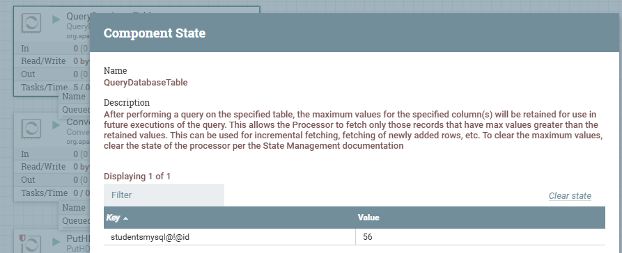